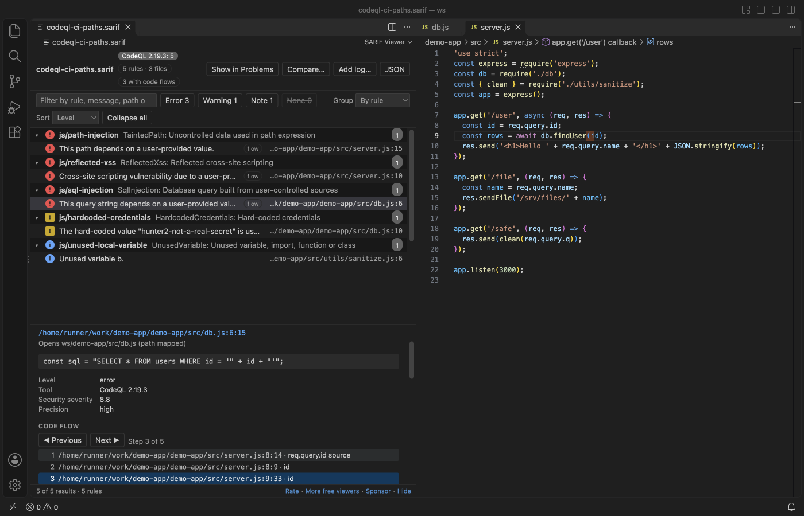
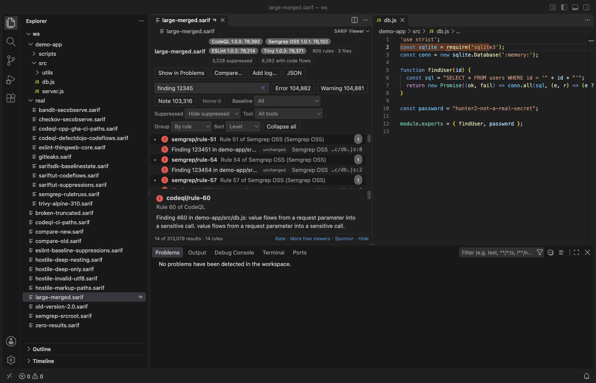
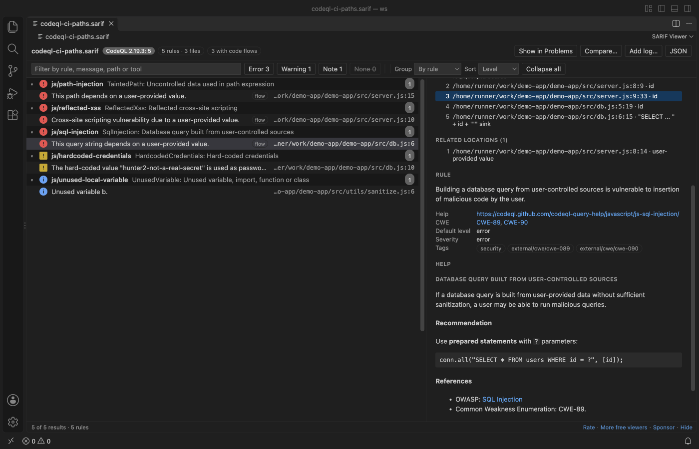
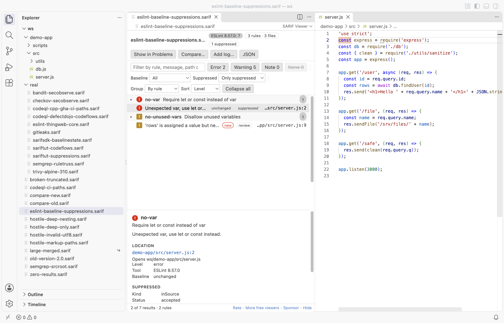
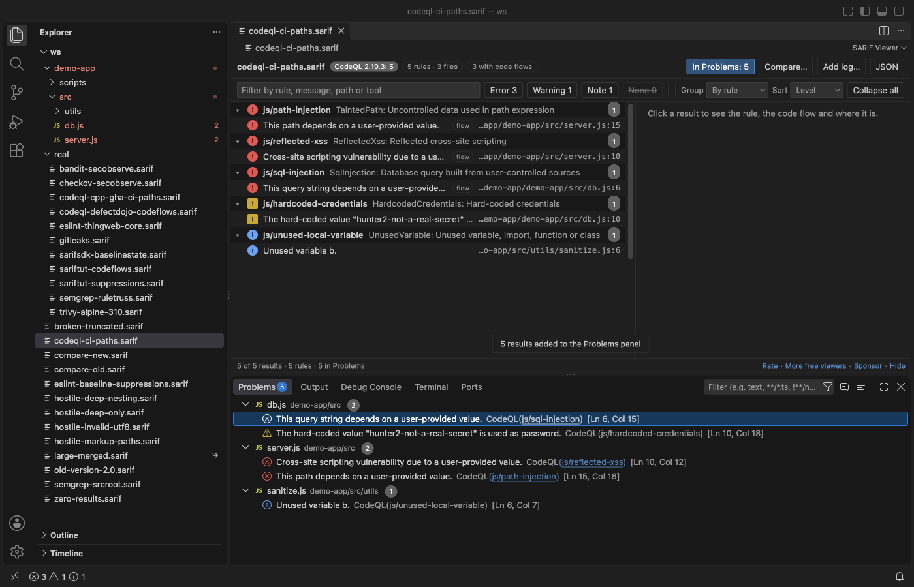
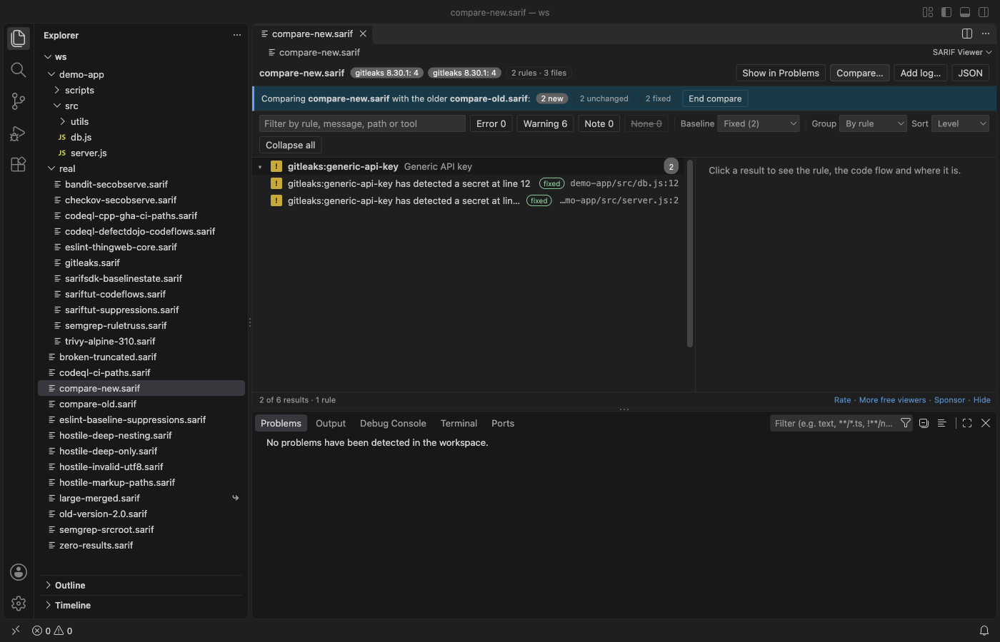

# SARIF Viewer (CodeQL, Semgrep & Static Analysis Results)

Open `.sarif` logs from CodeQL, Semgrep, ESLint, Bandit, Trivy, Checkov, Gitleaks and other scanners as a fast table in VS Code. Click a result to jump to its line, step through the code flow, and filter by level, baseline state and suppression. Free, no sign-in, works offline: the viewer sends nothing anywhere.

## What it fixes

The most-discussed issues and reviews of other SARIF viewers asked for these:

- Results from CI open the right file. Paths like `/home/runner/work/app/app/src/db.js`, `%SRCROOT%` and other `uriBaseId` values are matched to your workspace with a few file checks. The match is remembered for the workspace, so one result maps the whole log. If a file is not found, "Locate file" asks once. No search processes are started, ever.
- Filters for baseline state and suppressions. Show only `new` results, or `absent` ones, hide or show suppressed results with their justification, and filter by level, tool and text.
- "No results" is a clear success message, with the tool and rule count, so you know the scan ran. A run that did not finish says so.

## Features

- Opens `.sarif` and `.sarif.json` (SARIF 2.1.0; 2.0 files open with a note). Results are grouped by rule, file, level, tool or baseline state, worst first.
- Details pane: the message, the location with a snippet, rule help rendered from Markdown, the help link, CWE links, security severity, precision, tags, fingerprints and suppressions.
- Code flows: "Previous" and "Next" (or Alt+Up and Alt+Down) open each step in the editor beside the table. Related locations are links too.
- "Show in Problems" adds the results (with your filters) to the Problems panel. The rule code links to its help page. Click again, or close the log, and they are removed.
- "Compare…" marks each result new, unchanged or fixed against an older log, matched by fingerprint. "Add log…" shows several logs in one table with a tool column. You can also select two `.sarif` files in the Explorer and pick "Compare Two SARIF Logs".
- Keyboard: arrow keys, Page Up and Down, Home and End move through the table. Enter opens the result, and the left and right arrows fold a group.
- Dark, light and high-contrast themes follow VS Code.

## Large logs

The log is parsed in a background thread, and the table asks for only the rows on screen. A generated 150 MB log with 313,079 results from 4 tools showed its first rows 1.5 seconds after opening in VS Code 1.142 on a Mac. Jumping to the last row took 85 ms and a text filter took 0.8 seconds. The extension host used about 480 MB at the peak. Logs over 300 MB ask first (`sarifViewer.maxFileMB`), and logs over 500 MB get a message instead of a hang.

## Safe with logs you did not write

- Rule help and messages are Markdown with every character escaped first. Raw HTML, scripts and images show as text. Only `http` and `https` links are clickable, and they open in your browser only when you click them. A `javascript:` help link stays plain text.
- A result that points outside your workspace (for example `/etc/passwd`) asks before it opens. Network shares (`file://server/share`) and web addresses are never opened.
- The webview has a `default-src 'none'` Content Security Policy and makes no network requests. There is no telemetry and no account.

## Settings

| Setting | Default | What it does |
|---|---|---|
| `sarifViewer.groupBy` | `rule` | Grouping when a log opens |
| `sarifViewer.showSuppressed` | `hide` | Suppressed results: hide, show or only |
| `sarifViewer.pathMappings` | `{}` | Extra path maps, for example `{ "/home/runner/work/app/app": "/Users/me/app" }` |
| `sarifViewer.openBeside` | `true` | Open files beside the table |
| `sarifViewer.problemsLimit` | `5000` | Most results Show in Problems adds |
| `sarifViewer.maxFileMB` | `300` | Size that asks before parsing |

Commands: "SARIF: Compare Two SARIF Logs", "SARIF: Forget Remembered Path Mappings", "SARIF: Open a Sample SARIF Log".

## More screenshots

## Works in

VS Code 1.90 and newer, and editors that install from Open VSX (Cursor, Windsurf, VSCodium). It works over Remote SSH, WSL and in containers.

## Support Zovo

Zovo extensions are free, with no ads and no tracking. They are made by [theluckystrike](https://github.com/theluckystrike) on GitHub. If this one saves you time, you can support the work:

- [Sponsor on GitHub](https://github.com/sponsors/theluckystrike)
- [Follow theluckystrike on GitHub](https://github.com/theluckystrike)

## More tools by Zovo

- [Large JSON Viewer, JSON Browser & JSON Tree](https://marketplace.visualstudio.com/items?itemName=zovo.zovo-json-tree-viewer) shows large JSON files as a searchable tree, copies JSONPath and turns arrays of objects into a table.
- [PCAP Viewer & PCAPNG Viewer (Packet Capture Analyzer)](https://marketplace.visualstudio.com/items?itemName=zovo.zovo-pcap-viewer) opens PCAP and PCAPNG captures with a packet list, protocol tree, hex pane and display filters.
- [HAR Viewer & HAR File Analyzer (HTTP Archive, Network Log)](https://marketplace.visualstudio.com/items?itemName=zovo.zovo-har-viewer) opens HAR files from browser DevTools with a timing waterfall, filters and a redacted copy for sharing.
- [Hex Viewer & Binary Viewer, Hex Editor (Large Files)](https://marketplace.visualstudio.com/items?itemName=zovo.zovo-hex-viewer) opens files of any size as hex, with go to offset, search and a data inspector.
- [JSONL Viewer, Large JSONL Table & NDJSON Viewer](https://marketplace.visualstudio.com/items?itemName=zovo.zovo-jsonl-viewer) opens JSONL and NDJSON files as a table, as records or as a chat view.

See [all Zovo extensions on the Marketplace](https://marketplace.visualstudio.com/publishers/zovo).

## More from zovo

- [All free zovo VS Code extensions](https://marketplace.visualstudio.com/publishers/zovo) — file viewers, database clients, formatters. Offline, no telemetry, no sign-up.
- [Full MCP server catalogue](https://theluckystrike.github.io/mcp/) — local-first MCP servers for back-office work: invoices, VAT, PDFs, spreadsheets, payroll.
- [Hosted no-install MCP endpoints](https://mcp.zovo.one) — paste a URL in Claude / Cursor, nothing to install.
